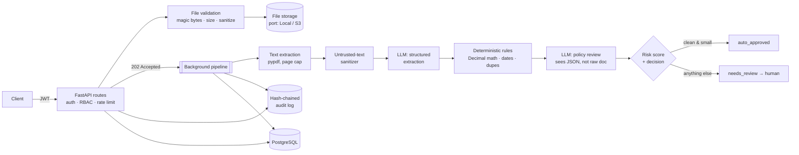

# LedgerLens — AI Accounts-Payable Automation API

> Upload an invoice → an LLM extracts the data → deterministic accounting checks →
> AI policy review → risk score → auto-approve or route to a human approver —
> with a tamper-evident audit trail.

**Stack:** Python 3.12 · FastAPI · LangChain (OpenAI / Anthropic Claude / Ollama) · PostgreSQL ·
SQLAlchemy 2 (async) · Alembic · Argon2 · JWT · Docker · pytest

## The real-world problem

Accounts-payable teams key in invoices by hand, catch math errors late, miss duplicate
payments, and enforce expense policy inconsistently. Duplicate and fraudulent invoices
are among the most common causes of corporate payment loss. LedgerLens automates the
boring 80% (clean, small, in-policy invoices) and gives humans a ranked queue of the
risky 20%, with every decision explainable and auditable.

## Architecture



### Layers (ports & adapters)

| Layer | Path | Knows about |
|---|---|---|
| API (HTTP adapter) | `app/api/` | FastAPI, DTOs, auth |
| Services (domain) | `app/services/` | business rules — no HTTP, no LangChain |
| AI adapter | `app/ai/` | LangChain + providers, behind the `AIService` Protocol |
| Persistence | `app/models.py`, `app/db/` | SQLAlchemy |
| Composition root | `app/main.py` | wires concrete implementations together |

Because the pipeline depends on the `AIService` **protocol**, tests inject a deterministic
fake (fast, free, offline) and production injects `LangChainAIService`. Swapping
OpenAI ↔ Claude ↔ local Ollama is one environment variable.

### Key design decisions & trade-offs

| Decision | Why | Trade-off / next step |
|---|---|---|
| **LLM reads, code decides** | LLMs are bad at arithmetic and can be manipulated. Totals, dates, duplicates and thresholds are checked with `Decimal` in pure functions. | The LLM's extraction can still be wrong → low confidence routes to a human. |
| **Structured output (Pydantic)** | Model output is schema-validated before touching business logic. | Small local models sometimes fail the schema → retried, then `failed` + admin reprocess. |
| **202 + background processing** | LLM calls take 5–60 s; never block the request. Status lives in the DB. | `BackgroundTasks` isn't durable across restarts. Moving to Celery/ARQ/Azure Service Bus only changes *who calls* `pipeline.run()`. |
| **Short DB sessions around LLM calls** | Holding a pooled connection for 60 s would exhaust the pool under load. | Duplicate check runs at write time, so two simultaneous identical invoices could both pass — a unique partial index would close that. |
| **Hash-chained audit log + DB trigger** | Finance needs non-repudiation. Edits/deletes are blocked by Postgres *and* detectable via `/audit/verify`. | Verification is O(n); add periodic checkpoints (signed anchor hashes) at scale. |
| **Row-level multi-tenancy (`org_id`)** | Simple, cheap, one schema. | Relies on every query filtering by org → enforced via a single `_get_owned` helper; Postgres RLS would add a DB-level guarantee. |
| **In-process rate limiter** | Zero infra for a single node. | Per-replica; swap the store for Redis when scaling horizontally. |

## Security model

| Threat | Control |
|---|---|
| Password theft | Argon2id hashing, min 12 chars, passwords never echoed in validation errors |
| User enumeration | Identical error + equalised timing for unknown email vs wrong password |
| Brute force | Rate limits on `/auth/*` and uploads (429 + `Retry-After`) |
| Token forgery / alg confusion | Pinned algorithm, required `exp/iss/aud/sub`, ≥32-char secret enforced at startup |
| Stale privileges | User + role re-read from DB on every request; deactivation is immediate |
| Broken access control / IDOR | RBAC (`admin` / `approver` / `submitter`); cross-tenant access returns 404 |
| Insider fraud | **Segregation of duties** — you cannot approve an invoice you submitted |
| Malicious uploads | Magic-byte sniffing (extension & Content-Type ignored), size cap, PDF page cap, encrypted PDFs rejected |
| Path traversal | Server-generated storage keys, resolved-path containment check, sanitized display names |
| Stored XSS via downloads | `Content-Disposition: attachment`, `nosniff`, strict CSP |
| **Prompt injection** | Invisible-char stripping, delimiter neutralisation, heuristic detection → high-risk flag, LLM has no tools/authority, second LLM sees only validated JSON, final decision is deterministic + human |
| Data leakage in logs | JSON logs with redaction of emails, card/account numbers, bearer tokens, API keys |
| Audit tampering | Hash chain + Postgres trigger blocking UPDATE/DELETE/TRUNCATE |
| Container compromise | Non-root user, read-only FS, `cap_drop: ALL`, `no-new-privileges`, DB not exposed |

## Run it

```bash
cp .env.example .env            # set LL_JWT_SECRET; choose a provider
docker compose --profile ollama up -d --build      # local LLM, no API key
docker compose exec ollama ollama pull llama3.1:8b  # first time only
# OpenAI / Claude instead: set LL_LLM_PROVIDER + key in .env, then: docker compose up -d --build
```

Open **http://localhost:8000/docs** for interactive API docs.

### Try the full flow

```bash
API=http://localhost:8000
curl -s -X POST $API/auth/register -H 'Content-Type: application/json' \
  -d '{"org_name":"Acme PH","email":"admin@acme-ph.com","password":"a-long-secure-password"}'
TOKEN=$(curl -s -X POST $API/auth/token -d 'username=admin@acme-ph.com&password=a-long-secure-password' | jq -r .access_token)
H="Authorization: Bearer $TOKEN"

# Set the company's expense policy
curl -s -X PUT $API/org/policy -H "$H" -H 'Content-Type: application/json' \
  -d "$(jq -Rs '{text: .}' samples/expense_policy.txt)"

# Upload a clean invoice and a suspicious one (contains a prompt-injection attempt)
curl -s -X POST $API/documents -H "$H" -F file=@samples/invoice_clean.txt
curl -s -X POST $API/documents -H "$H" -F file=@samples/invoice_suspicious.txt

curl -s "$API/documents?status=needs_review" -H "$H" | jq    # the human review queue
curl -s $API/audit/verify -H "$H" | jq                        # {"valid": true, ...}
```

### Local development & tests

```bash
python -m venv .venv && source .venv/bin/activate
pip install -r requirements-dev.txt
pytest -q          # 30 tests, SQLite + fake AI: no network, no keys, ~30 s
ruff check .       # lint (includes bandit-style security rules)
pip-audit          # known-vulnerability scan of dependencies
```

## API overview

| Method | Path | Role | Purpose |
|---|---|---|---|
| POST | `/auth/register` | public | Create org + first admin |
| POST | `/auth/token` | public | OAuth2 password login → JWT |
| GET | `/auth/me` | any | Current user |
| POST/GET | `/users` | admin | Manage users & roles |
| GET/PUT | `/org/policy` | any / admin | Expense policy used by AI review |
| POST | `/documents` | any | Upload invoice (202) |
| GET | `/documents` | any | List, filter by status, paginate |
| GET | `/documents/{id}` | any | Extraction, findings, policy review, risk |
| GET | `/documents/{id}/file` | any | Download original (audited) |
| POST | `/documents/{id}/decision` | approver/admin | Approve / reject (SoD enforced) |
| POST | `/documents/{id}/reprocess` | admin | Retry a failed document |
| GET | `/audit`, `/audit/verify` | admin | Audit trail & integrity check |
| GET | `/health/live`, `/health/ready` | public | Liveness / readiness probes |

## Roadmap

- OCR for scanned images (Tesseract or a vision model) behind the same `extract_text` port
- Durable job queue + retries with backoff; outbox pattern for ERP sync (SAP/QuickBooks/Xero)
- Refresh tokens with rotation + revocation list (`jti` is already in the token)
- Postgres Row-Level Security as a second tenant-isolation layer
- Vendor master data matching (known TIN/bank account → fraud signal on change)
- LLM evaluation harness: labelled invoice set, per-field accuracy per provider/model
- OpenTelemetry tracing across API → pipeline → LLM calls
